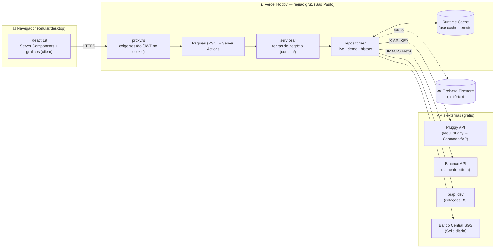

# Arquitetura



## Fluxo de uma visita

1. O **proxy** confere o cookie `mm_session` (JWT HS256). Sem sessão válida, redireciona para `/login`.
2. A página é **parcialmente pré-renderizada**: cabeçalho, navegação e *skeletons* saem do HTML estático na hora.
3. Cada card fica dentro de um `<Suspense>` e chega por **streaming** assim que os dados dele ficam prontos. Um banco lento não segura o card da Binance.
4. Os **serviços** verificam a sessão de novo (defesa em profundidade) e usam `React.cache` para que várias seções da mesma página compartilhem uma chamada só.
5. Os **repositórios live** chamam as APIs dentro de funções `"use cache: remote"`. O resultado fica no Runtime Cache da Vercel, compartilhado entre instâncias e preservado entre deploys.

## Cache: quanto tempo cada dado vale

Os perfis estão definidos em [next.config.ts](../next.config.ts):

| Dado | Perfil | Revalida em segundo plano após | Expira após |
|---|---|---|---|
| Preços cripto | `prices` | 1 min | 15 min |
| Saldos Binance | `balances` | 5 min | 1 h |
| Santander / XP (Open Finance) | `bank` | 15 min | 24 h |
| Cotações B3 (brapi) | `quotes` | 30 min | 24 h |
| Categorias Pluggy, Selic BCB | `reference` | 12 h | 7 dias |

- O modelo é *stale-while-revalidate*: quem abre o app recebe o cache na hora, e a atualização acontece por trás.
- O botão **Atualizar** (ícone ↻) chama `updateTag` em todas as tags e força dados novos na próxima leitura.
- Erros **não** entram no cache: a função lança a exceção, o repositório converte em um estado "erro" e a próxima visita tenta de novo.
- A API Key da Pluggy (válida por 2 h) fica em memória e é renovada com 10 minutos de folga.

## Camadas e desacoplamento

```
components (UI)  →  services  →  repositories (interfaces)  →  integrations (HTTP)
                        ↓                 ↑
                     domain (puro)    live | demo | history(noop → Firestore)
```

- `domain/` não sabe de onde vêm os dados. Recebe `Transaction[]` e devolve salário, fatura etc., e é 100% testável.
- `repositories/index.ts` é **o único lugar** que escolhe a fonte (demo, live e, depois, Firestore).
- Toda resposta vem num envelope `Sourced<T>` (`live`, `demo`, `fallback`, `unconfigured` ou `error`, mais avisos). A UI mostra um selo com a origem de cada dado.

## Segurança

| Risco | Mitigação |
|---|---|
| Secrets no navegador | Ficam só em `process.env` no servidor. O pacote `server-only` quebra o build se um Client Component importar `server/`. |
| Acesso sem login | `proxy.ts` em todas as rotas e `requireSession()` em toda leitura de dados. |
| Senha | Guardada só como hash **scrypt** (N=32768). A comparação usa `timingSafeEqual`. |
| Força bruta | 5 tentativas por IP a cada 15 min, mais um atraso de 800 ms por erro. |
| Sessão | Cookie `httpOnly`, `secure` em produção, `sameSite=lax`, JWT HS256 com expiração (30 dias por padrão). |
| Open redirect | `next` do login só aceita caminhos internos. |
| Binance | Key **somente leitura**. `npm run check:binance` acusa se trade ou saque estiverem habilitados. |
| Clickjacking / indexação | `X-Frame-Options: DENY`, `noindex`, `robots.txt` bloqueando tudo. |
| Olhares por cima do ombro | Botão 👁 borra todos os valores (fica salvo no aparelho). |
